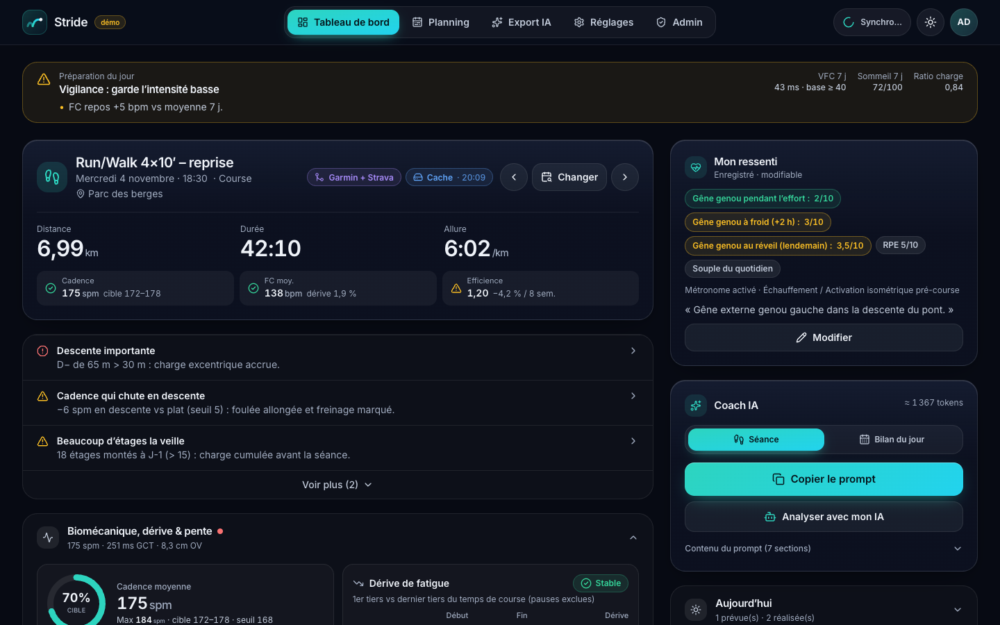
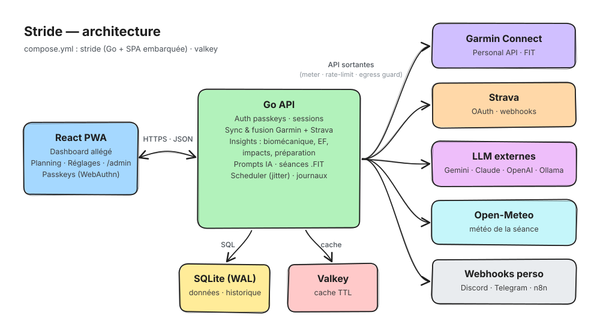

# Stride

[](https://github.com/aguyonp/stride/actions/workflows/ci.yml)
[](https://github.com/aguyonp/stride/releases)
[](https://github.com/aguyonp/stride/pkgs/container/stride)
[](backend/go.mod)

Stride merges your Garmin and Strava telemetry, computes biomechanics, aerobic efficiency, cumulative impact, ACWR load and readiness, structures Macro/Méso/Micro training cycles, correlates localized musculoskeletal stress with shoe wear and terrain, and streams AI-coach analyses in real time. Plans export to `.FIT`, clinical views share via revocable read-only links, and authentication uses WebAuthn passkeys only.



## Quick start

```bash
git clone git@github.com:aguyonp/stride.git && cd stride
grep -qs STRIDE_MASTER_KEY .env || printf 'STRIDE_MASTER_KEY=%s\nSTRIDE_UID=%s\nSTRIDE_GID=%s\n' \
  "$(openssl rand -base64 32)" "$(id -u)" "$(id -g)" >> .env
mkdir -p data && docker compose up -d
open http://localhost:8080
```

- **First account = admin**; others join by invitation. Integrations are optional, set per user in the app.
- **Back up `STRIDE_MASTER_KEY`**: it encrypts every stored credential and share link (`AES-256-GCM`).
- Passkeys need HTTPS except on `localhost`. Private image: `docker login ghcr.io` (`read:packages`).

## Highlights

**4.2.0**
- Physio / coach portal on share links: directives with restrictions, session remarks, prescribed sessions and events, per-session detail (each permission opt-in).
- Coach notes injected first into every AI prompt, plan generation and adaptation (quoted, capped).
- Smart Workout Morphing: today's or tomorrow's session adapted to pain, load, heat, wind and physio restrictions; refine with AI, apply, revert, `.FIT`.
- Atomic SQLite backups (daily, before migrations, on demand) with SHA-256, local retention and S3-compatible upload.
- SQLite split into one writer and a read-only pool.
- French / English interface and AI prompts, following the browser language by default (switch in Settings, `Cmd+K`, login and share pages).

**4.1.0**
- Five menus (Tableau de bord, Planning, Santé & forme, Coach IA, Réglages) and a header search button (`Cmd+K`).
- Health status as the single source of the injury focus; symptoms recorded once, in the body map.
- Full history import from Garmin and Strava (resumable job) and search over all sessions.
- Share links scoped by period and sections, with anonymization.
- Pathology catalog per body zone (ankle, hip, lower back, forefoot…) plus a custom condition.
- Real shoe mileage from Strava gear; pairs retired or deleted on Strava show as retired.
- Admin control center (overview, users, jobs, share links, maintenance) and in-app user feedback.

**4.0.0**
- Macro / méso / micro training cycles with planned vs actual tracking.
- Body map (6 zones) with correlations computed only from measured data.
- Revocable read-only share links for a physio or a coach.
- Real-time updates over SSE (job progress, AI token streaming), in-process background jobs.
- Goose migrations, `stride doctor`, Prometheus metrics on a private listener.

## Architecture



Detailed guides: [Architecture & Data Flows](docs/ARCHITECTURE.md) · [Prometheus Metrics & Alerts](docs/METRICS.md) · [Specification](docs/SPEC.md) · [Garmin API Facts](docs/GARMIN_API.md).

## Release cycle

One SemVer string, no `v`: `VERSION` file = git tag = image tag = `GET /version` & Settings footer.

| Trigger | Image `ghcr.io/aguyonp/stride` | Version |
| --- | --- | --- |
| push to a branch | `dev` | `4.1.0-dev` |
| merge into `main` | `prerelease` | `4.1.0-pre` |
| tag `4.1.0` | `latest` + `4.1.0` + GitHub release | `4.1.0` |

1. Bump `VERSION` in your PR (`make changelog` previews the notes), merge, validate `prerelease`.
2. On an up-to-date `main`, `make release` pushes the tag with its changelog; CI builds `latest` + `4.1.0` and publishes the release (a tag ≠ `VERSION` fails).
3. Deploy or roll back: `STRIDE_TAG=<tag> docker compose up -d`.

## Configuration (`.env`)

| Variable | Default | Purpose |
| --- | --- | --- |
| `STRIDE_MASTER_KEY` | **required** | AES-256-GCM key for credentials and share links at rest |
| `STRIDE_PUBLIC_URL` | `http://localhost:8080` | Public URL (passkeys, OAuth, invite & share links) |
| `STRIDE_VALKEY_URL` | — (`redis://valkey:6379/0` in Compose) | Valkey URL for the TTL cache and SSE Pub/Sub |
| `STRIDE_METRICS_ADDR` | — (disabled) | Private listener for `GET /metrics` (e.g. `:9090`, not published) |
| `STRIDE_REGISTRATION` | `invite` | `invite` or `open` |
| `STRIDE_STRAVA_CLIENT_ID` / `_SECRET` / `_WEBHOOK_TOKEN` | — | Enable Strava OAuth & webhooks |
| `STRIDE_HOST_BIND` / `STRIDE_HOST_PORT` | `127.0.0.1` / `8080` | Published address |
| `STRIDE_ALLOW_PRIVATE_EGRESS` | `false` | Allow a local LLM / webhook / S3 endpoint (e.g. Ollama, MinIO) |
| `STRIDE_S3_ENDPOINT` / `_REGION` / `_BUCKET` / `_PREFIX` | — / `us-east-1` / — / — | Seed the backup S3 target once (then edited in Admin › Backups & S3) |
| `STRIDE_S3_ACCESS_KEY_ID` / `_SECRET_ACCESS_KEY` | — | S3 credentials (secret sealed at rest, never returned) |
| `STRIDE_S3_PATH_STYLE` / `_AUTO_UPLOAD` / `_RETENTION_DAYS` | `false` / `false` / `30` | Path-style URLs (MinIO, Garage), upload the daily snapshot, remote retention (0: keep) |

Full list: [docs/SPEC.md](docs/SPEC.md) §9.

## Development

```bash
make dev            # Go API on :8080 (in-memory cache)
make dev-frontend   # Vite on :5173 (npm run dev:mock for mocked data)
make test           # Go race tests + frontend Vitest suite
make docker-up      # Build locally and start docker compose (stride + valkey)
```

## Star history

[](https://star-history.com/#aguyonp/stride&Date)
