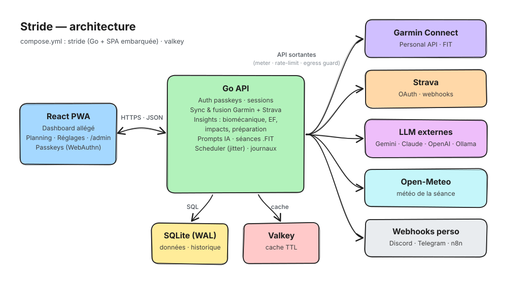

# Stride 4.0.0 — Architecture & Data Flows

Stride is a self-hosted, multi-user sports telemetry, training periodization, and clinical biomechanics platform packaged as a **single statically linked Go binary** serving an embedded **React 19 + TypeScript PWA**, backed by **SQLite (WAL)** for durable state and **Valkey** for ephemeral caching, distributed worker queues, and real-time Pub/Sub.

---

## 1. Runtime Topology (`compose.yml`)

| Component | Technology | Responsibility |
| --- | --- | --- |
| **HTTP API & SPA Host** | Go 1.26 (`net/http`), embedded Vite bundle | Passkey WebAuthn auth, CSRF/CSP security headers, OpenAPI v3 exposition, SSE `/api/events/stream`, Prometheus `/metrics`, public `/version` & `/share/:token`. |
| **Durable Storage** | SQLite (`modernc.org/sqlite`, WAL, `foreign_keys = ON`) | Users, passkeys, encrypted provider credentials, immutable activity bundles, Macro/Méso/Micro training cycles, Body Stress Map entries, share links, and job status history. |
| **Cache, Queue & Pub/Sub** | Valkey 9 (`valkey-go` + `hibiken/asynq`) | TTL cache (`stride:cache:*`), weighted priority worker queues (`critical`, `default`, `low`), distributed sync locks, WebAuthn/OAuth ceremonies, and SSE fanout. Automatically falls back to an in-memory engine when `STRIDE_VALKEY_URL` is unset (`make dev` / unit tests). |

---

## 2. Versioned SQL Migrations & Schema Verification (`internal/database`)

Stride uses **`pressly/goose/v3`** without any ORM:
- Numbered `.up.sql` and `.down.sql` pairs live in `backend/internal/database/migrations/` (`00001_platform` through `00006_v4`) and are compiled into the binary via `//go:embed`.
- **Lossless v3.x Upgrade Bridge**: On startup, before executing `goose.Provider.Up`, Stride inspects whether a legacy `schema_migrations` table exists. Any version already recorded in `schema_migrations` (`0001`..`0005`) is seeded into `goose_db_version` so upgrading a live v3.x SQLite file applies only `00006_v4.up.sql` with zero data loss.
- **Startup Integrity Gate (`VerifySchema`)**: Immediately after migrations complete, Stride runs `PRAGMA quick_check`, `PRAGMA foreign_key_check`, and verifies the presence of every required table and v4 column before accepting HTTP traffic.

---

## 3. End-to-End Typed Contract (`OpenAPI v3` → `TypeScript`)

Backend structs are the single source of truth for API wire shapes:
1. `backend/internal/openapi` reflects over Go request/response structs and registered `httpapi` routes to emit a deterministic **OpenAPI 3.0.3** document.
2. Exposed live at `GET /openapi.json` and `GET /openapi.yaml`, and exported via `stride openapi ../docs` into `docs/openapi.json` and `docs/openapi.yaml`.
3. On the frontend, `npm run generate:api` invokes `openapi-typescript ../docs/openapi.yaml -o src/api/schema.d.ts`, feeding `src/api/openapiClient.ts` so route signatures and camelCase JSON properties remain locked at compile time.

---

## 4. Asynchronous Worker & Priority Queues (`internal/queue`)

Heavy I/O and CPU-bound tasks never block HTTP handlers. They are dispatched onto three weighted priority queues backed by Valkey (`hibiken/asynq`, with an in-memory priority worker pool fallback when `STRIDE_VALKEY_URL` is empty):

| Queue | Weight | Job Types | Retry Policy |
| --- | --- | --- | --- |
| `critical` | `6` | `import.activity` (`.FIT` / `.GPX` / `.TCX` parsing & traces), `llm.analyze`, `llm.plan_generate`, `llm.plan_adapt` | Exponential backoff, interactive priority |
| `default` | `3` | `sync.provider` (Garmin & Strava sync + shoe & activity fusion), `sync.strava_webhook`, `webhook.deliver` (Discord / Telegram / JSON) | Exponential backoff (replaces volatile in-memory timers) |
| `low` | `1` | `sync.resync` (full historical user resynchronization) | Exponential backoff, background priority |

Every job state transition (`queued` → `running` → `retrying` / `completed` / `failed`) and item counter (`processed` / `total`, e.g. *"Synchro Strava : 3/5 séances traitées"*) is persisted in `async_jobs` (`GET /api/jobs`, `GET /api/jobs/{id}`) and pushed immediately over SSE.

---

## 5. Native Server-Sent Events & Token Streaming (`internal/sse`)

React polling (`refetchInterval`) has been completely eliminated in favor of a single authenticated stream at `GET /api/events/stream`:
- Mounted **outside** `gzhttp` compression middleware with cleared `WriteDeadline` (`http.NewResponseController(w).SetWriteDeadline(time.Time{})`) so frames flush instantaneously.
- Sends an initial `connected` event and a `: heartbeat <unix>` comment every 20 seconds, releasing subscriber channels cleanly on `<-r.Context().Done()`.
- **Event taxonomy**:
  - `job.updated` & `sync.updated`: live worker progress bars and automatic TanStack Query cache invalidations upon job completion.
  - `alert.triggered`: immediate toast notifications when post-session ACWR overload, HRV drop, or high biomechanical stress is detected.
  - `llm.token` & `llm.done`: **token-by-token streaming** from Gemini, Claude, OpenAI, or Ollama directly into the Analysis Drawer and Plan Generator UI.
  - `meter.updated`: live provider quota telemetry pushed to connected administrators.

---

## 6. Domain Engines Introduced in 4.0.0

### 6.1 Three-Tier Training Periodization (`/api/cycles`)
Models long-term preparation up to a target race across three relational levels:
1. **Macrocycle (`training_plans`)**: Global preparation block anchored to a target event/goal (`startDate` → `endDate`, `targetEventLabel`). Supports automatic periodization scaffolding (`autoScaffold`).
2. **Mesocycle (`plan_phases`)**: Multi-week physiological blocks (`foundation`, `build`, `threshold`, `specific`, `assimilation`, `taper`, `recovery`) carrying target weekly volume (`weeklyVolumeKm`) and target weekly load (`targetWeeklyLoad`).
3. **Microcycle (`training_weeks`) & Workouts (`planned_sessions`)**: Monday-aligned training weeks with assimilation week flagging (`isAssimilation`) and itemized workouts. Stride continuously reconciles **Planned vs Actual** volume (km), load, and session completion across every tier for the zoomable Gantt view in `/plan`.

### 6.2 Body Stress Map & Correlation Engine (`/api/bodymap` & `internal/analysis`)
Tracks localized musculoskeletal stress (`0–10` during/day score + `0–10` next-morning cold stiffness `coldNextDayScore`) across 6 canonical runner zones:
- `knee_pfps` (Rotule / Genou — SFP), `achilles` (Tendon d'Achille), `plantar_fascia` (Aponévrose plantaire), `shin_splints` (Périoste tibial), `iliotibial_band` (Bandelette ilio-tibiale / TFL), `hamstrings_calves` (Ischio-jambiers / Mollets).
- `internal/analysis/bodymap.go` crosses symptomatic episodes (`score >= 3`) against asymptomatic baseline runs across five factors: **shoe drop (`mm`)**, **cumulative shoe wear (`km`)**, **negative elevation (`D- m`)**, **ground contact time (`GCT ms`)**, and **cumulative impact load**.
- Active pain history and statistically meaningful correlations are automatically injected (`### CARTOGRAPHIE CORPORELLE & CORRÉLATIONS`) into every AI Coach Markdown prompt.

### 6.3 Security & Read-Only Physio / Coach Share View (`/share/:token`)
- **Secrets at rest**: Provider credentials, webhook tokens, and share URLs are sealed with **`AES-256-GCM`** (`internal/secret.Sealer` keyed by `STRIDE_MASTER_KEY` with domain-separated AAD).
- **Share Links (`share_links`)**: Generated from 256 bits of `crypto/rand` entropy (`st4_…`). SQLite stores **only** `SHA-256(token)` for constant-time lookup plus the `AES-256-GCM`-encrypted URL so owners can copy links in Settings while plaintext tokens never touch disk.
- **Strict Read-Only Boundary**: `GET /api/public/share/{token}` (`Cache-Control: private, no-store`) enforces optional expiration and instant 1-click revocation, returning exclusively clinical load, cycle progress, session summaries, Body Stress Map, and shoe wear correlations — never exposing GPS tracks, personal settings, API keys, or write endpoints.
